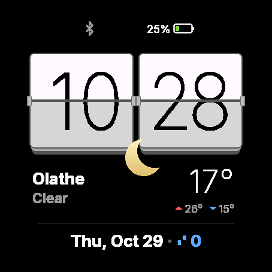

# Sensory for Garmin Venu 3

A flip clock watch face for the Venu 3. It is a port of the Pebble watch face [Sensory by MintCarasique](https://apps.repebble.com/sensory_aa1f75d4f2b747049c91e60f), which recreates the HTC Sense flip clock.

It runs on a real Venu 3 (sideloaded) and in the Connect IQ simulator. It supports the Venu 3 only. See **Status** below.



## What it shows

- Two flip tiles with the time. A tile flips when its value changes, with the flap swinging out in perspective like the Pebble original, and the digits spin through random values when you open the face, for example on return from a menu. A wrist raise only flips the tiles whose time changed while the screen was dim.
- Weather from Open-Meteo. An icon, the city, the condition, the temperature, and one extra line of your choice (high and low, sunrise and sunset, chance of rain, or wind).
- Bluetooth (dim when the phone is disconnected), Quiet Time and battery in the status bar.
- The date, with one optional metric beside it (steps, distance, active calories or heart rate).
- A low-power frame for the AMOLED screen: dim dark tiles, light-gray digits and dim text, kept under Garmin's always-on limit of 10% screen luminance. It shifts a few pixels every minute.

## Settings

Set these in the Garmin Connect app, or on the watch itself: long-press the face and open its settings. Both read the same table in `tools/gen_settings.py`.

| Setting | Choices |
|---|---|
| Language | Same as watch, English, Russian, German, Polish, Spanish, Belarusian |
| Time format | Same as watch, 24-hour, 12-hour |
| Tiles | Light, dark |
| Font | Roboto, Inter |
| Next to the date | Steps, distance, active calories, heart rate, nothing |
| Date format | By language, 28.10.2026, 28/10/2026, 10/28/2026, 2026-10-28 |
| Show weather | On, off |
| Under the temperature | High and low, sunrise and sunset, chance of precipitation, wind |
| Temperature | Celsius, Fahrenheit |
| Location | Current location, fixed city |
| City | Used for a fixed city |
| Name on the watch | A short name shown instead of the city |
| Update every | 15 minutes, 30 minutes, 1 hour, 2 hours |
| Power saving | Automatic, always on, off |

Power saving turns off the animations and halves the weather update rate. In automatic mode it applies at 20% battery or below, or in Quiet Time.

## Behavior that differs from the Pebble version

- **The flip only animates while the screen is awake.** The Venu 3 spends most of its time in low-power mode, where a watch face cannot animate, so a minute that changes while the screen is dim just updates.
- **Current location** comes from Garmin's own weather data on the watch, which follows your phone's location. If the watch has no Garmin weather, the face falls back to the watch's last GPS fix. With neither, weather shows `--`; use a fixed city in that case.
- **Active calories** are total calories minus the resting burn for the part of the day gone (Mifflin-St Jeor). If your Garmin profile lacks weight, height or birth year, the face shows total calories.
- **Both fonts are bundled** as bitmaps, because the Venu 3 has no bold Roboto of its own.
- **Old weather is hidden.** Weather older than three update intervals shows as `--` instead of passing for current.
- **Long city names** are shortened with an ellipsis to keep clear of the weather icon.
- **City names in other scripts** (Ukrainian, Serbian, Greek and so on) show gaps, because the bundled fonts cover Latin, Russian and Belarusian. Set **Name on the watch** to a name the fonts can draw.
- **A weather fetch that fails** leaves the old weather in place until it goes stale. The face asks again after at most ten minutes of stale weather.
- **Pebble Time 2 Quick View** has no Garmin equivalent and is not ported.

## Status

Every feature below was checked on a real Venu 3.

| Area | State |
|---|---|
| Flip tiles, digit spin, wrist-raise behavior, low-power frame | Checked |
| Weather, city, every line under the temperature, fixed city, Celsius and Fahrenheit | Checked |
| Status bar, date row, steps, distance, active calories, heart rate, the large date with weather off | Checked |
| Light and dark tiles, Roboto and Inter, all six languages | Checked |
| On-watch settings menu | Checked |
| Unit tests (dates in all six languages, weather codes and formatting, forecast parsing, sun times, active calories, long dates, the flip state machine and its timing) | 16 tests, all passed in the simulator |
| Settings screens in Garmin Connect | Not checked. They only appear for a store install, so they need a beta upload |

## Requirements

- macOS.
- Java 11 for the Connect IQ compiler (the Microsoft OpenJDK 11 works).
- [uv](https://docs.astral.sh/uv/) for the generator scripts. Each script declares its own dependencies, so `uv run` fetches Pillow on first use.
- The Connect IQ SDK 9.3.0, unpacked next to this project at `~/Work/connectiq-sdk/`.
- The Venu 3 device, installed with the Connect IQ SDK Manager.
- A developer signing key at `~/.garmin/dev.der`. Garmin requires a 4096-bit RSA key in DER format. Set `CIQ_KEY` to use another path. Keep a backup, because Garmin only accepts store updates signed with the same key.

## Build and run

The helper scripts live in `tools/`.

```sh
tools/run.sh              # build, start the simulator, load the face
tools/build.sh            # build into build/
tools/test.sh             # build with unit tests and run them in the simulator
tools/package.sh          # optimized release package for the Connect IQ store
```

A `Makefile` wraps the same scripts, so `make run`, `make build`, `make release`, `make test` and `make package` work too. `make help` lists every target.

`make test` exits non-zero when the tests fail, when they do not compile, or when none ran.

Without the scripts, one build is a single compiler call.

```
monkeyc -d venu3 -f monkey.jungle -o build/sensory-venu3.prg -y ~/.garmin/dev.der -w
```

## Install on a watch

You can run the face on your own Venu 3 without publishing it.

1. Run `make release`. It writes the optimized `build/sensory-venu3.prg`, signed with your key.
2. Connect the watch over USB. Recent Garmin watches use MTP, which macOS cannot open on its own, so use an MTP app such as OpenMTP if the watch does not appear in Finder.
3. Copy the `.prg` into `GARMIN/APPS` on the watch.
4. Unplug the watch and pick Sensory from the watch face list.

Garmin Connect only shows settings for apps installed through the store, so on a sideloaded face use the settings on the watch: long-press the face and open its settings. On a store install, a later sync from Garmin Connect may overwrite what you changed in the watch menu. This is not verified.

Weather needs the phone paired and the Garmin Connect app running, because the watch fetches it through the phone.

## Layout

| Path | Contents |
|---|---|
| `source/` | The Monkey C source. `SensoryView.mc` draws the face. `Flip.mc` holds the tile drawing and the flip state machine. `Theme.mc` holds the tile colors for light, dark and the low-power frame. `SettingsMenu.mc` is the on-watch settings menu, and `SettingsTable.mc` is generated. `SensoryApp.mc` starts the app and schedules the weather refresh. `WeatherService.mc` is the background service that fetches weather and the city. `Weather.mc` holds the weather codes, forecast parsing, formatting and freshness check. `Settings.mc` reads the settings. `Strings.mc` holds the six language tables. `Icons.mc` draws the weather and status icons. `Health.mc` estimates active calories. `Tests.mc` holds the unit tests. |
| `resources/` | The launcher icon, weather icons, generated settings XML and the Inter and Roboto bitmap fonts, all sized for the Venu 3's 454px screen. |
| `tools/` | The shell scripts behind the `Makefile`, the Python generators for settings, fonts and icons, and the Inter and Roboto font files. |

The settings XML in `resources/settings/` and `resources/strings/` is generated by `tools/gen_settings.py`. The Inter and Roboto bitmap fonts are generated by `tools/gen_fonts.py`, and the launcher icons by `tools/gen_icons.py`. Run them with `make settings`, `make fonts` and `make icons`. Edit the generator, not the output.

## Data sources

- Weather comes from [Open-Meteo](https://open-meteo.com), which needs no API key.
- City names come from OpenStreetMap [Nominatim](https://nominatim.org), cached until the watch moves about 10 km. Put a real contact string in the `User-Agent` header in `source/WeatherService.mc` before you publish.

## Credits and licenses

- The original Pebble watch face is by MintCarasique.
- Inter is licensed under the SIL Open Font License (`tools/fonts/Inter-OFL.txt`). Roboto is licensed under the Apache License 2.0 (`tools/fonts/Roboto-LICENSE.txt`).
- The launcher icon is drawn by `tools/gen_icons.py` and is not taken from the Pebble version.
